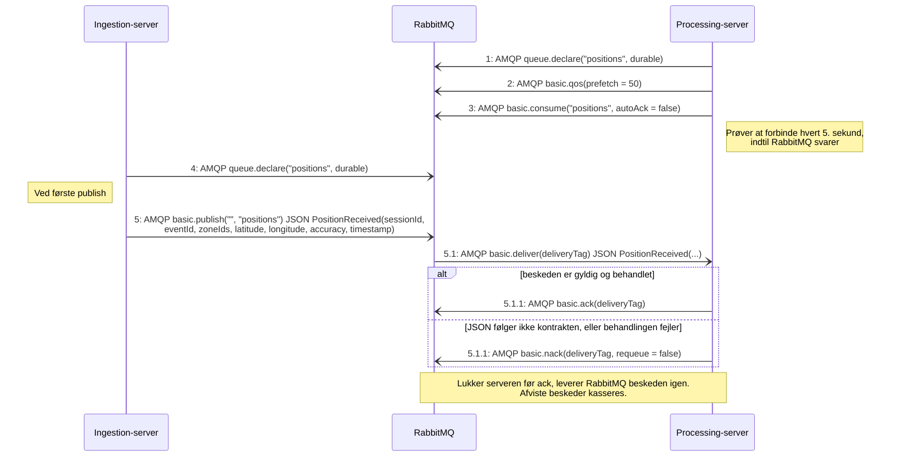
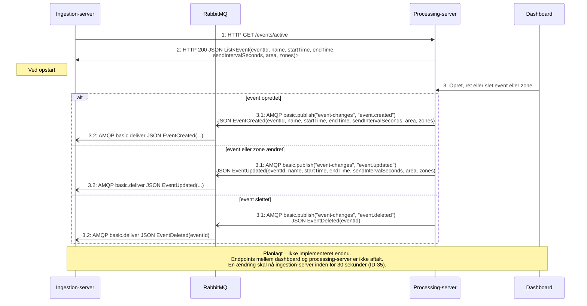

# Protokol: AMQP via RabbitMQ (ingestion-server ↔ processing-server)

De to servere taler sammen gennem RabbitMQ (AMQP 0-9-1, `localhost:5672`, bruger `crowdcontrol`). Kontrakt: `contracts/asyncapi/messaging.yaml` og `contracts/schemas/rabbitMQ/`. PlantUML-versioner: `protocol-behandl-position.puml` og `protocol-event-changes.puml`. Overblik: `protocol-overview.md`.

- **Format:** `application/json` (Jackson i Java, `System.Text.Json` med web-defaults i C#). Tidspunkter er ISO 8601 i UTC.
- **Status:** Positions-køen (Java → C#) er implementeret. Exchangen `event-changes` (C# → Java) og `GET /events/active` ved opstart står i kontrakterne, men er ikke lavet endnu. Indtil da bruger ingestion-server et demo-event (`DemoEventSeeder`).

## Behandl position



## Event-ændringer (planlagt)



## Beskeder

**`PositionReceived`** på køen `positions` (alle felter påkrævet):

```json
{
  "sessionId": "3f2c1a9e-6b7d-4e8f-9a0b-1c2d3e4f5a6b",
  "eventId": "00000000-0000-0000-0000-000000000001",
  "zoneIds": ["00000000-0000-0000-0000-00000000000a"],
  "latitude": 55.86,
  "longitude": 9.85,
  "accuracy": 8.5,
  "timestamp": "2026-10-24T18:22:18Z"
}
```

`zoneIds` er tom, hvis positionen ligger i eventet, men uden for alle zoner, og har flere elementer, hvis zonerne overlapper. Samme JSON bruges i `PosDataTest` (Java) og `PositionMessageTests` (C#), så begge sider testes mod samme besked.

**`EventCreated` / `EventUpdated`** (planlagt): hele eventet efter `Event` i `contracts/schemas/shared/common.v1.json`, dvs. `eventId`, `name`, `startTime`, `endTime`, `sendIntervalSeconds`, `area` (polygon) og `zones` (`zoneId`, `name`, `area`). Kapacitet sendes ikke, da den kun bruges i processing-server.

**`EventDeleted`** (planlagt): `{ "eventId": "…" }`.

| Kanal | Retning | AMQP | Besked | Status |
|---|---|---|---|---|
| `positions` | Java → C# | Default exchange, routing key = kønavn, durable kø | `PositionReceived` | Implementeret |
| `event-changes` | C# → Java | Exchange, routing key `event.created` / `event.updated` / `event.deleted` | `EventCreated` / `EventUpdated` / `EventDeleted` | Planlagt |
