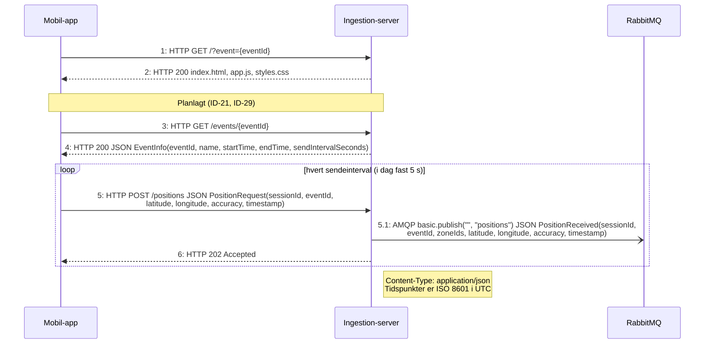
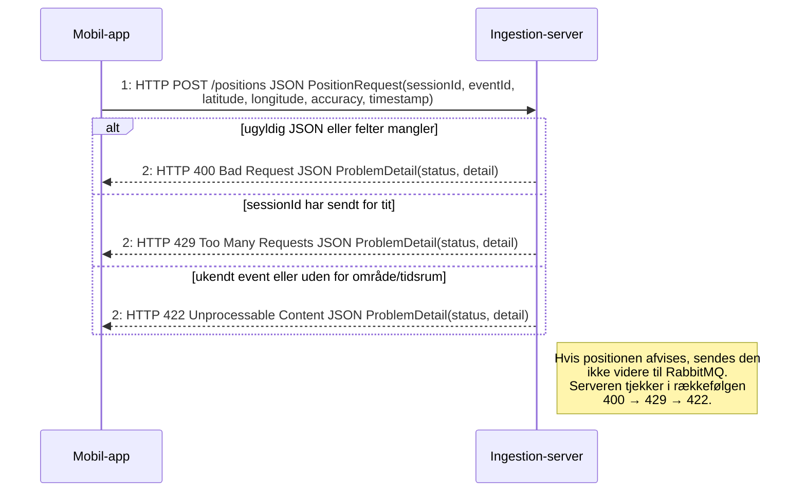

# Protokol: Ingestion-API (mobil-app → ingestion-server)

REST over HTTP(S) med JSON mellem mobil-appen (`app.js`) og ingestion-server (Java). Kontrakt: `contracts/openapi/ingestion-api.yaml`. PlantUML-versioner: `protocol-send-position.puml` og `protocol-send-position-fejl.puml`. Overblik: `protocol-overview.md`.

- **Transport:** HTTP på `localhost:8080` lokalt. I tilstanden `LAN` går trafikken via en Cloudflare-tunnel med HTTPS, da browsere kun tillader Geolocation API på `https://` og `localhost`.
- **Format:** `application/json`, alle tidspunkter ISO 8601 i UTC. Fejl returneres som `application/problem+json` (Springs `ProblemDetail`).
- **Status:** `GET /` og `POST /positions` er implementeret. `GET /events/{eventId}` står i kontrakten, men er ikke lavet endnu (mobil-appen bruger et fast interval på 5 sekunder).

## Send position



## Send position_Fejl



## Beskeder

**`POST /positions` – request** (`PositionRequest`, alle felter påkrævet):

```json
{
  "sessionId": "3f2c1a9e-6b7d-4e8f-9a0b-1c2d3e4f5a6b",
  "eventId": "00000000-0000-0000-0000-000000000001",
  "latitude": 55.86,
  "longitude": 9.85,
  "accuracy": 8.5,
  "timestamp": "2026-10-24T18:22:18Z"
}
```

| Felt | Type | Regel |
|---|---|---|
| `sessionId` | UUID | Pseudonymt, laves i browseren med `crypto.randomUUID()` |
| `eventId` | UUID | Fra `?event=` i linket |
| `latitude` | tal | −90 til 90 |
| `longitude` | tal | −180 til 180 |
| `accuracy` | tal | ≥ 0, meter (`coords.accuracy`) |
| `timestamp` | ISO 8601 | Hvornår positionen blev målt |

**Svar:**

| Kode | Betydning | Mobil-appens status |
|---|---|---|
| 202 | Modtaget og sendt videre | "Din position deles." |
| 400 | Ugyldig body | "Der skete en fejl. Prøv at genindlæse siden." |
| 422 | Uden for eventets område eller tidsrum | "Du er uden for eventets område, eller eventet er ikke aktivt." |
| 429 | Rate limit for dette `sessionId` | Uændret (ikke brugerens fejl) |

Se `PositionController`, `RestExceptionHandler` og `ReceivePositionService`.
