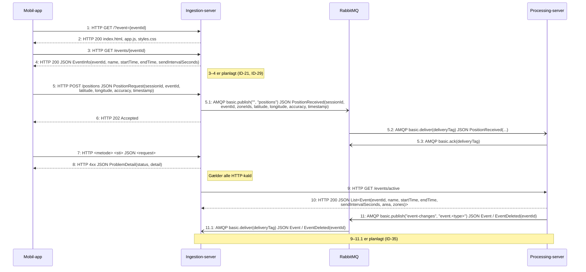

# Kommunikationsprotokol

Overblik over al kommunikation mellem mobil-appen, ingestion-server, RabbitMQ og processing-server. Tegnet i samme stil som `Kommunikationsprotokol.asta`: nummererede beskeder, hvor hver besked viser protokol, format og indhold. PlantUML-version: `protocol-overview.puml` (stil i `astah-style.iuml`).

Detaljer pr. protokol:

- `protocol-ingestion-api.md` – HTTP mellem mobil-app og ingestion-server (*Send position*, *Send position_Fejl*)
- `protocol-amqp.md` – AMQP mellem serverne (*Behandl position*, *Event-ændringer*)

**Notation** (som i Astah):

- Fuld pil med lukket spids: synkront kald (HTTP-request). Stiplet pil: svar.
- Pil med åben spids: asynkron besked (AMQP).
- `1`, `2` … er rækkefølgen; `5.1` er en besked, der sendes som følge af `5`.
- Lyserøde noter forklarer, hvad der gælder flere beskeder, eller hvad der er planlagt.
